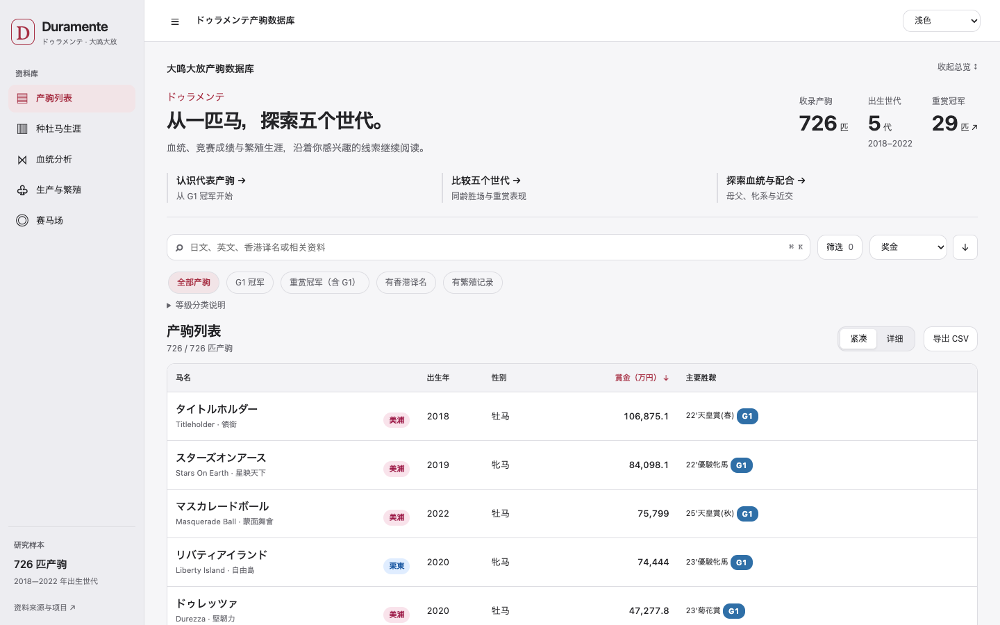
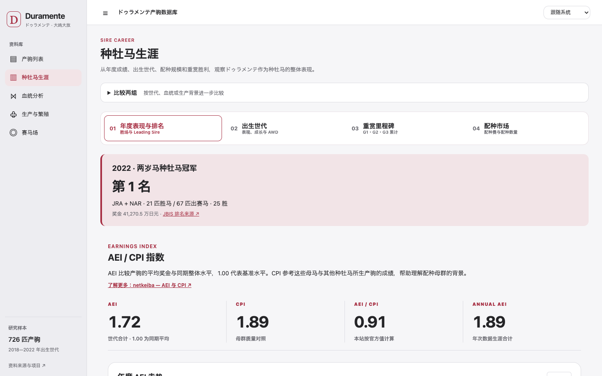

# Duramente Progeny Database

**ドゥラメンテ（大鸣大放）产驹数据库**

浏览马匹资料与赛绩，比较血统和繁育表现，探索产驹在不同赛马场的成绩。当前收录 **2018–2022 年出生的 726 匹产驹**，无需注册或登录。

**[打开数据库 ↗](https://dacron92mr.github.io/duramente-progeny-database/)**

## 从一匹马开始

首页总览展示全库规模、出生世代与重赏冠军，提供代表产驹、同龄世代比较、血统分析三个入口。总览可以收起，便于连续浏览列表。搜索、筛选与排序放在一起；紧凑／详细切换和 CSV 导出位于表格上方。

在「产驹列表」输入日文名、英文名或已收录的香港官方译名，也可使用已有别名搜索。按出生年、性别、所属、母父、牝系、生产牧场等条件组合筛选，或使用 G1 冠军、有香港译名、有繁殖记录等快捷选项。

- **紧凑 / 详细列表**：紧凑模式优先显示身份、奖金与主要胜鞍；详细模式补充母系、马主、练马师等资料。手机端使用卡片。
- **主要胜鞍**：赛事名称后显示小型等级标识，区分 G、Jpn 与障碍 J.G；没有可靠等级标注时仅显示名称。等级筛选保留原数据库分类，具体赛事以比赛记录为准。
- **排序与导出**：支持排序和每页 20 / 50 / 100 匹。CSV 导出全部当前筛选结果，保留当前排序，不受页码影响。
- **继续浏览**：筛选、页码和马匹详情保存在网址中，便于分享或返回；显示偏好保存在本机。可用 `Cmd/Ctrl + K` 快速搜索。



## 快速查看与完整资料

点击马名打开 **快速查看（Quick View）**，查看基本身份、照片、生涯战绩、主要胜鞍和累计奖金，并可跳转相关母父、牝系或生产牧场的产驹。

切换至 **完整资料（Full Profile）** 后，按三个部分继续阅读：

| 部分 | 可以查看的内容 |
| --- | --- |
| 身份与血统 | 父母、母父、牝系、母龄与胎次、已核实的同母黑体马及原有同母重赏资料、Cross、DP / DI / CD |
| 竞赛生涯 | 生涯概览，按年度、场地或距离分组的表现、逐场赛果，以及有资料时展示的退役后去向 |
| 繁殖生涯 | 已收录的种牡马或繁殖母马记录、配种与生产资料及来源链接 |

照片位于身份信息附近。多张照片可连续「换一张」，Quick View 与 Full Profile 切换会保持当前照片；可直接打开 netkeiba 照片列表。外部图片暂时无法加载时保留来源入口，没有照片时不显示大块空白。

退役后记录独立于繁殖资料，显示日期、当时所属、地点及来源。已确认经历与计划分开呈现，不把过去记录表述为当前所在地。

固定导航整合马名、分段、前后匹与关闭。页面支持浅色与深色主题、键盘操作及手机阅读。资料缺失保持留空或显示「—」，不补造名称、成绩或等级。

## 从单马到群体比较

| 页面 | 主要用途 |
| --- | --- |
| **种牡马生涯** | 直接查看年度表现与排名、出生世代、重赏胜利记录和配种市场；突出 2022 年两岁马种牡马冠军 |
| **血统分析** | 按具体母父、六大母父系或牝系分组，结合世代、性别和最少样本量比较胜马率、重赏马比例；继续探索母父系、牝系、Cross、Nicking 与 Dosage |
| **生产与繁殖** | 比较生产牧场等分组，并查看繁殖母马、母龄、胎次、配种月份与出生月份等资料 |
| **赛马场** | 从地图或列表选择赛马场，查看出赛数、胜场、胜率、前三率，继续查看对应产驹及场地、距离表现 |

原有专业栏目和核心图表直接可见；出生世代优先展示同龄累计胜场与重赏表现，奖金、胜距、成长等次级图表置于「进一步探索」，完整数据表仍可展开查看。需要 A/B 比较时，再展开「比较两组」。可用下拉菜单选择 **A / B**，也可点击图中对象选择 A。血统散点图以不同颜色、外圈和字母标识两组，并同步更新比较卡片；即使坐标重合，也保留真实位置和两个标识。点击「查看产驹」可回到对应筛选结果。

DP / DI / CD、AEI / CPI、AWD 等术语在相关分析附近提供简短解释和参考链接。详细口径放在可展开的「统计说明」中；概念参考与真实数据来源分开标注。



### 如何阅读赛马场地图

地图展示有坐标记录的 JRA / NAR 赛马场，可切换赛事体系、区域及地图 / 列表，支持缩放和平移。

- **圆圈大小代表胜场数量**，胜场越多越大；零胜场也保留可见标记。
- **带数字的虚线圆表示附近赛马场数量**，不是胜场。点击后放大区域，并可选择具体赛马场。
- 点选单场可查看简洁成绩卡，再进入对应产驹或更详细的场地与距离分析。海外赛马场资料仍可在赛马场分析中查看。

### 各赛事体系采用不同的分析方式

- **全部**：先看 JRA、NAR、海外各自的出赛与胜场，再进入对应分析。
- **JRA**：分别比较草地与泥地；排行与场地比例默认至少 30 场，可切换门槛。
- **NAR**：以泥地为主，盛冈草地另列；全部明细保留小样本的真实比例。
- **海外**：按马匹阅读国家或地区、赛马场、赛事、等级和赛果，不用少量出赛排列胜率。合成跑道独立分类。

## 数据范围与统计口径

本库固定收录上述五个出生世代的 726 匹产驹。自动更新不会自行增加或删除收录马匹；现役马的赛果、生涯资料与奖金会继续更新。已核实的香港官方译名与用于搜索的别名分开保存。

胜马率描述一组产驹中至少取得一胜的马匹比例；单场胜率描述比赛中的获胜比例，两者分母不同。统计用于观察和比较样本，不代表血统或繁育因素与成绩之间存在因果关系。

<details>
<summary>了解统计与来源差异</summary>

- 工作区胜马率以所选组全部收录产驹为分母；存在无法识别的生涯战绩时，改称「已确认胜马比例」，未知记录不当作真实未胜。
- 重赏马比例沿用原数据库的 G1 / G2 / G3 分类，不据此重新归类 Jpn、地方或障碍赛事。
- 单马与赛马场的胜率、前三率按有正式名次的比赛计算；取消、未完成和名次缺失不补零，原始比赛记录仍保留。
- AEI、CPI 采用 JBIS 公布的中央平地赛口径；AEI/CPI 为本站使用同次公布值计算的比值。不同来源的奖金及统计范围可能不同，应结合页面来源阅读。
- 样本量、年龄、参赛机会、繁殖母马质量、训练与赛程都可能影响比较结果。本项目不提供投注建议。

维护者可参阅 [数据结构与统计定义](docs/DATA_SCHEMA.md)。

</details>

## 数据来源与更新

资料主要整理自 netkeiba、JBIS、Japan Stud Book、香港赛马会及其他公开赛马和血统资料。单马资料和相关分析保留来源入口；第三方照片由现有外部来源加载，本站不重新分发照片目录中的图片。

| 来源 / 内容 | 更新方式 |
| --- | --- |
| netkeiba 赛果、生涯资料及可取得的国内赛事奖金 | 每周检查全库 |
| JBIS 逐匹资料 | 按限速要求分批处理，计划每月完成一轮 |
| JBIS AEI / CPI、重赏 AEI 与世代指数 | 每周检查种牡马汇总页 |
| 血统、官方译名、繁殖及历史研究资料 | 人工核验或专用流程维护，不随普通赛果同步任意覆盖 |

更新先暂存、重建相关统计并校验，通过后才发布。来源暂时不可用或数据异常时保留已有记录。网站是**定期更新的静态数据库，并非实时赛果服务**。

## 开发与维护

使用原生 HTML / CSS / JavaScript、ECharts 和静态 JSON，通过 GitHub Pages 发布。网站无需构建；从仓库根目录启动本地静态服务即可预览：

```sh
python3 -m http.server 8765 --bind 127.0.0.1
```

打开 `http://127.0.0.1:8765/`，不要使用 `file://`。修改时保留相对资源路径，以兼容 GitHub Pages 的项目子目录。

- [本地运行、自动化测试与故障排查](docs/DEVELOPMENT.md)
- [架构与模块职责](docs/ARCHITECTURE.md)
- [数据所有权、来源与官方译名维护](docs/DATA_SCHEMA.md)
- [界面设计系统](docs/UI_DESIGN_SYSTEM.md) · [统一用语](docs/UX_COPY.md)
- [本轮验收、资料审计与修改前后截图](docs/qa/post-merge/REVIEW.md)
- [上一轮发布验收](docs/qa/release/UI-CORRECTIONS.md)
- [参与维护](CONTRIBUTING.md) · [报告数据错误或问题](https://github.com/Dacron92mr/duramente-progeny-database/issues)

测试包括纯函数、数据处理、图表校验，以及列表、Profile、研究流程、照片和手机交互的浏览器回归。运行方法见开发文档；批量 QA 截图不随站点分发。

---

这是独立的赛马爱好者研究项目，与 JRA、JBIS、netkeiba、Japan Stud Book、香港赛马会或其他资料提供方无隶属关系。数据和页面仍在持续整理中，欢迎提供可核验的更正资料。
