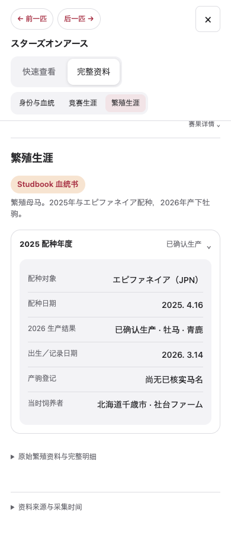
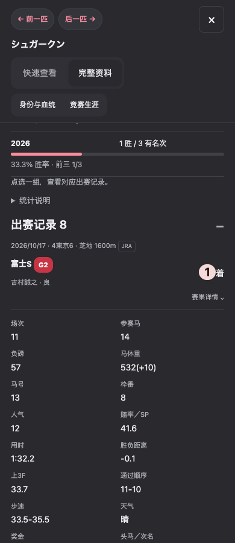
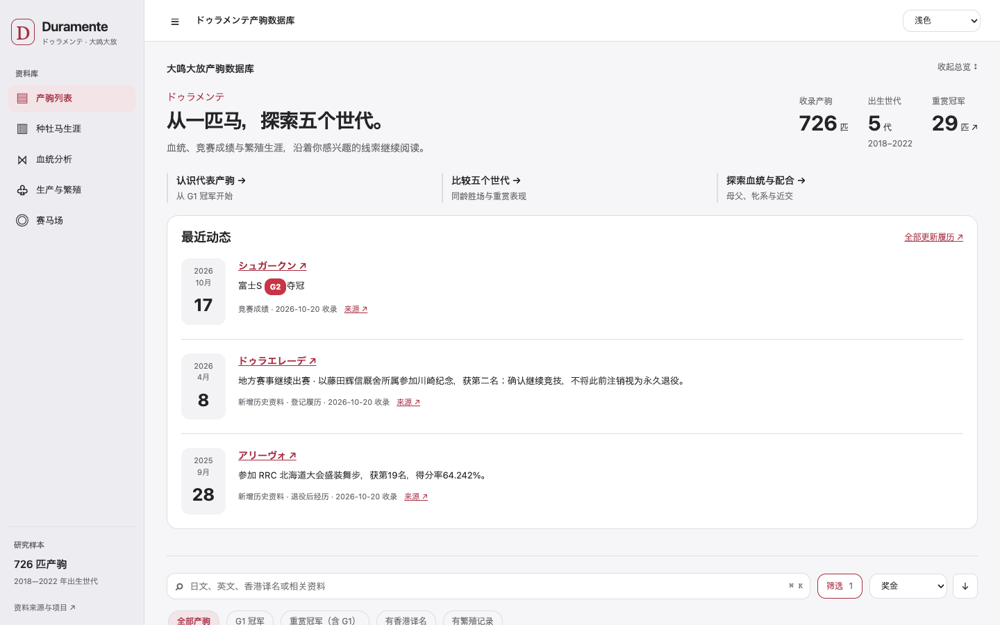

# 生涯履历与资料阅读

本分支接续 PR #3，按用户提供的三张布局参考实现繁殖年度卡片、手机赛果展开行及最近动态。保持原始 726 匹档案、赛果和统计不变；不新增单马对比或分析仪表盘。

## 所属与登记

- 列表练马师、马主筛选和搜索匹配全部已收录的来源确认记录，每个筛选内按马匹去重。选项数字是对应产驹数量，不是胜场。
- 首批从既有来源快照整理 692 匹的所属观察，70 匹存在不同练马师名称。观察日期不冒充转厩日期；不根据比赛举办地推断所属。
- Full Profile 的人物区显示最后确认所属及来源时间线；登记变化独立显示，退役后去向继续保留已确认／当时计划的区别。
- Dura Erede 的池添学、藤田辉信及中央注销、地方继续出赛由 [JRA 公告](https://jra.jp/news/202512/121112.html) 和 [NAR 逐场记录](https://www.keiba.go.jp/KeibaWeb/DataRoom/HorseMarkInfo?k_lineageLoginCode=30005401576) 补证。2023 东京大赏典仍归池添学，不能因赛事在大井而归入地方厩舍。
- 任职胜场仅由带来源的逐场归属计算，界面明确标为部分已核实记录。历史起止期不完整时，不分摊或推断整段生涯成绩。未取得历史来源的马匹只保留已知字段。
- 周更从明确标注的练马师／马主字段追加来源观察；旧记录保留。金额与赛果原有验证保持有效。

## 繁殖资料

繁殖母马按配种年度组织，最新年度展开；生产结果明确标注次年。无法与配种记录唯一对应的生产记录按实际生产年度单列，不猜配种年份。已有明确身份链接可打开；仅有名字时不猜链接。

未受孕、流产、死产、出生后死亡、已确认生产、预计生产及结果待报告分别显示。没有预产日期不再被判断为未受孕。种牡马按供用年度显示费用与配种／生产／登记数量，零值保留。原始记录和来源入口可展开。

## 赛果与动态

桌面保留表格与展开明细；手机显示日期、赛马场、距离、体系、赛事、等级及名次，点击展开负磅、马体重、赔率、用时等。全部按日期连续排列，逐场区分 JRA／NAR／海外，不按马匹最终所属统一分类。原始记录没有删减。

首页最近动态连到独立 `updates.html`；完整履历可按收录日期、产驹、类型筛选。事件日期与收录日期分开，旧资料标为新增历史资料。生成器记录实际数据变更并去重；页面随对应网站版本成功部署后才可见，不把生成日期伪称部署成功日期。初始化仅挑有明确证据的既有事件，不回填成虚构更新日志。

## 验证与边界

Chrome、WebKit：390、430、768、1440 px，深浅色。检查年度展开、手机逐场展开、桌面表格、两任练马师筛选、登记及后续出赛分开、历史更新筛选、抽屉无横向溢出。旧 Profile 导航及模式切换回归通过。

来源观察不是完整转厩档案；缺少历史资料不表示从未转厩。未核实的马主变化、任职期、退役去向不会自动补写。保留原始数据及此前照片切换。

## 实际浏览器截图

最终验证：41 项 Node 测试、49 项 Python 测试通过；全部现有浏览器回归及新增生涯回归通过。总览收起后，1440×900 可完整显示 7 行紧凑列表，每行 70 px。原始马匹文件及分析数据与 PR #3 逐文件比较无变化。
