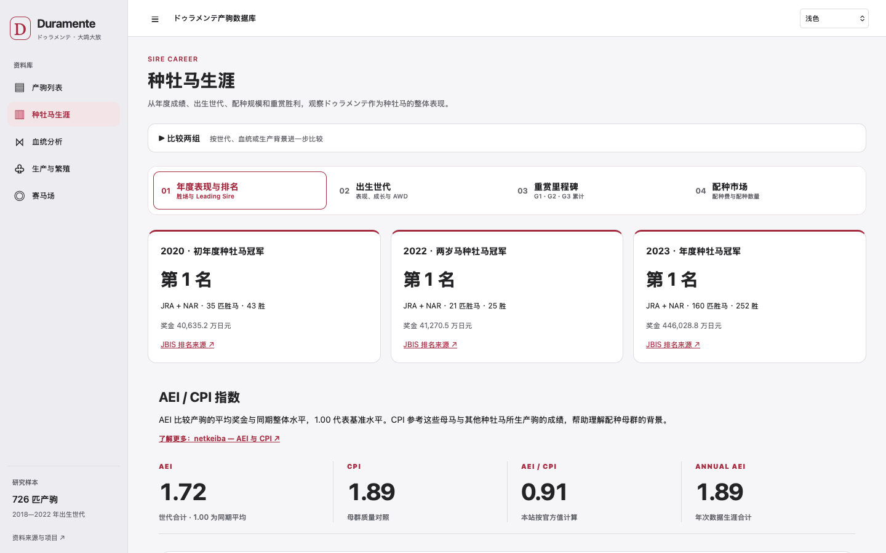
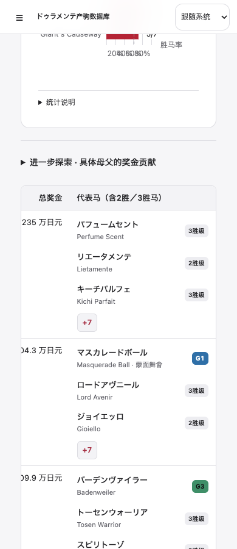
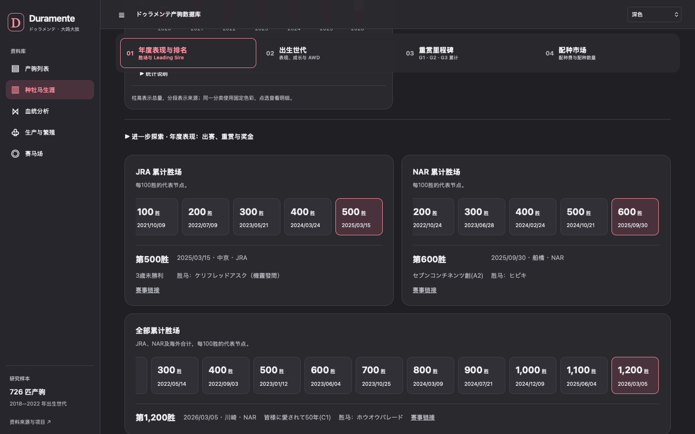

# PR #3：胜鞍、同母资料与更新可靠性

## 本轮变化

- 主要胜鞍中的条件赛、OP、Listed 与分级赛统一为紧凑标签；天皇赏的「春」等赛事名称括号不受影响。Icon Taylor 的 JBC Ladies Classic 明确显示 JpnI；等级不从马匹最高成就反推。
- 血统代表马改为简洁姓名行，仅等级标签保留强调色。小屏可横向浏览表格，不再被固定首列遮盖。
- 2020 年首季、2022 年两岁马及 2023 年综合种牡马冠军并列。两岁排名奖金默认选 2022 年，之后尊重读者自行选择。
- 三组累计胜场里程碑采用一致的紧凑按钮、日期与比赛详情；生产与繁殖的桑基图默认全部马主。
- 同母黑体资料以母马名单和具体赛果为依据，包含合资格赛前三名，非仅冠军。公开资料未取得、源站明确暂无赛绩、赛事资格待核定分别记录。Melody Lane 置于「其他知名同母马」。

## Sugar Kun 更新修复

已核对 [JRA 富士锦标结果](https://www.jra.go.jp/datafile/seiseki/replay/2026/095.html) 与 [netkeiba 马匹赛绩](https://db.netkeiba.com/horse/result/2021102224/)，补入 2026-10-17 富士锦标 G2 胜绩。原有七场比赛完整保留；726 匹收录范围、官方译名、其他马匹原始记录不变。相关衍生统计按既有算法重建。

10 月 19 日周更报告显示任务成功且检查 725 个登记 ID，但变更名单不包含 Sugar Kun。旧流程没有独立的最新胜绩核对，不能根据该报告证明是某一具体缓存层故障。此处修复的是“陈旧或不完整快照可能被当作成功更新”的缺口：

1. 对照静态赛绩、公开动态赛绩与生涯出赛数；矛盾或缺场不静默发布。
2. 全库批次独立核对 JRA 当年官方重赏胜马；已知胜绩遗漏会阻止发布。
3. 保存逐马检查时间、最新比赛日期、记录数及错误报告；对来源暂时不同步进行有限重试。
4. 保留周一 08:23 香港时间更新，增加周二同一时刻补查。逐匹 JBIS 月度计划不变。

两份同样陈旧的 netkeiba 快照缺少富士锦标时，新增测试确认 JRA 核对会拒绝发布。该机制不保证第三方永不延迟，也不将无法取得来源的批次冒充成功。

## 同母核查范围

`data/verified_siblings.json` 保存已核实条目及全体 726 匹的核查状态；`data/sibling_race_designations.json` 保存逐场、逐年的资格依据。`black_type_siblings.json` 在正常统计重建时合并这些证据，避免周更覆盖人工核验结果。

自动提取 JRA 平地 G / Listed 前三名；地方、海外、历史等级及仅标 OP 的赛事必须另核当年资格。Jpn 等国内标识仍原样保留，国际 L / LR / G 依据单独链接。不把 OP 全部视为 Listed，不把未收录当作没有同母黑体马。

资料来源包括 netkeiba 的按母马检索名单与逐场赛果、NAR 年度国际赛事名单、对应年度 International Cataloguing Standards，以及 NYRA 官方赛事报道。Melody Lane 的母系和赛绩另由 JBIS 核实。

本次取得 629 份母马产驹名单，逐一检查 4,861 个马匹条目：4,017 个有可读赛绩，844 个源站明确暂无赛绩。全体 726 匹产驹都有核查状态；Style Presa 的完整同母名单与 Daiya 的海外同母名录仍待补足。

核查有公开资料覆盖边界，**这不是完整黑体名录认证**。具体数量与缺失状态以数据中的核查日期和逐马记录为准；尚缺赛绩、无法取得完整同母名单或资格依据不足的对象继续明确保留待核状态。

复核方法（原始网页缓存不提交、不公开分发）：

```sh
python3 scripts/audit_siblings.py --cache /path/to/private-cache --output /path/to/audit.json
python3 scripts/audit_siblings.py --cache /path/to/private-cache --output /path/to/audit.json --offline --reclassify
python3 scripts/build_verified_siblings.py /path/to/audit.json
python3 scripts/build_black_type_siblings.py
```

## 实际页面





## 验证

已检查 Chrome 与 WebKit，覆盖 390、430、768、1440 px 和深浅色模式。现有列表、Profile、研究、照片、地图、导航与本轮功能回归均已执行。WebKit 触控检查包括照片切换、Quick View / Full Profile 状态保留、地图缩放和产驹导航。测试照片的失败回退与受控图片场景不代表第三方图片永久可访问。

单元测试覆盖等级显示、JBC 的具体赛事映射、同母身份、前三名资格、OP 待核状态、源站赛绩矛盾和官方胜绩遗漏。PR 保持开放，未合并到 main。
