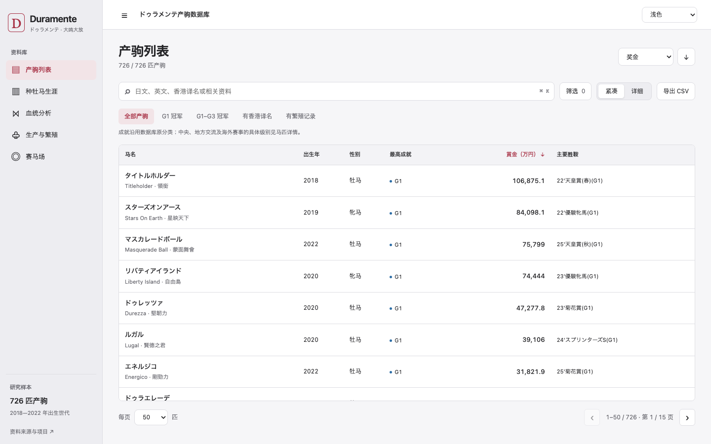

# 前端重构交付与审阅记录

日期：2026-10-14。界面基线提交：`71ec0da`；提交前已接入主分支 `afd4e38` 的例行 JBIS 指数更新。本次范围是现有静态网站的界面、探索体验和维护结构；研究数据没有迁移。提交位于独立审阅分支，合并到主分支并完成 Pages 部署后才会影响正式站。

## 仓库审计

- 入口是 `index.html`、`app.js`、`style.css`；运行时为原生 JavaScript、ECharts 和静态 JSON。没有生产构建步骤，`.nojekyll` 保留。
- 原 `app.js` 同时负责状态、获取、筛选、列表、详情和领域分析；原 `style.css` 超过四千行，混合旧导航、列表、详情和图表布局。原有图表工具、亲缘关系模块及语义色模块已经具有可复用边界。
- 快照收录 **726 匹产驹、726 份详情**；687 条记录有英文名，69 条有官方香港译名。这里只报告审计快照，不把这些数量写成永久测试常量。
- 数据既有人工研究资料，也有生成统计和混合所有权文件。年度奖金、配种市场、排名、血统、dosage 等不能用赛果推导值整体覆盖。详见 [数据所有权](DATA_SCHEMA.md)。
- 周更 netkeiba、按月分批 JBIS 单马资料、每周 JBIS 种牡马指数及原有安全同步流程保留。此次没有运行抓取、重建研究数据或修改更新周期。
- 本地运行并检查原页面后，保存了四种宽度的浅深主题基线。原列表可见列受空间限制、英文名未进入主列表层级、筛选长期占据桌面宽度；已存在的领域分析及其计算保留。
- `status` 包含登记状态、性别及年龄混合值，`summary.json` 不由现有周更自动重建。这两项记录为明确的数据维护边界，没有推断新状态。

## 设计与已实现功能

设计采用中性灰侧栏、白色/深灰内容面、酒红选中态、细分隔线、原生系统字体与统一 4/8px 间距。保留赛车等级、世代、母父系、牝系等既有语义颜色；普通导航和容器减少装饰性颜色。桌面侧栏可折叠，平板和手机用临时导航。

产驹列表支持日文主名、英文及官方香港译名次级展示；既有别名只用于搜索。默认六列紧凑模式，详细模式保留原有字段及内部横向滚动，马名列/表头固定；手机用卡片，完整资料始终可在详情中访问。显示偏好保存在本地。

增加快捷筛选、可折叠高级条件、逐项移除条件、搜索清空、Cmd/Ctrl+K、20/50/100 每页、页码/范围及 URL 恢复。快捷条件与原条件共用状态及筛选函数。G1/G1–G3 按原库字段筛选，没有重解释 Jpn、地方或海外赛事。

CSV 导出全部当前筛选结果并保持排序，使用固定 21 列 schema、UTF-8 BOM、CRLF、字段转义和公式注入防护。不会只导出当前页或修改来源数据。

详情保留赛绩、血统、奖金、同母重赏兄弟姐妹、繁殖、来源、前后匹和深链接；新增请求过期保护、重试状态、来源日期展示、背景 inert、焦点约束/恢复及 Escape。外部照片加载失败时保留来源链接，并设置超时回退。

四个分析大类及全部原子页保留，应用统一主题和容器。分析标签支持方向键、Home/End；放大图表和焦点恢复经过浏览器验证。统计定义、分母、排名、样本及语义色未改写。

## 架构与性能

- 将状态、URL、数据获取、搜索/筛选/排序/分页、表格/卡片、详情、主题、偏好、CSV、对话框和图表库加载分为职责模块；依赖显式传入。
- CSS 按 tokens、foundations、shell、progeny、detail、analysis 六个边界维护；`style.css` 仅保留入口导入。清理已被新界面取代的选择器和重复声明，列表规则不再影响分析表格。
- 领域图表定义暂留 `app.js`，避免在同一次界面重构中迁移高耦合统计逻辑。`chart-analysis.js` 改为显式 `configure()`，保留原有纯计算及测试接口。
- 请求 Promise 合并并缓存；失败释放缓存以便重试。列表、相邻马匹和导出共用一次完整筛选/排序结果的语义，保持分页，不引入虚拟列表。
- ECharts 延迟到进入分析页加载。初始列表浏览器检查确认不请求 ECharts，同一次列表初始化仅请求一次 `horses.json`。
- 新图表创建只应用自身主题，移除了每创建一张图就遍历已创建图表的重复工作；隐藏图不进行即时主题刷新，重新显示时恢复。减少动画并尊重 reduced-motion。
- 新依赖仅为开发测试用 Playwright，版本锁定；网站仍无框架、无生产依赖安装、无构建要求。没有宣称未测量的提速百分比。

## 验证结果

| 检查 | 结果 |
| --- | --- |
| 研究数据 SHA-256 对比 | 界面修改前后 765 个文件哈希不变；接入例行更新后再次对比最新主分支，765 个数据文件无差异 |
| 新增 Node 纯函数/数据不变量 | 8 项通过，真实清单/详情关联使用动态数量 |
| 原有 Python 单元测试 | 30 项通过 |
| 图表颜色、Sankey、图表设计、同母关系、研究图表校验 | 5 个脚本通过 |
| 世代/奖金/场地洞察校验 | 通过 |
| JavaScript 语法及 diff 空白检查 | 通过 |
| 浏览器完整回归 | 26 组通过，0 个 JavaScript 运行错误 |
| 视口与主题 | 390 / 768 / 1280 / 1440px，浅色与深色；页面无横向溢出 |
| GitHub Pages 路径 | 在隔离服务的 `/duramente-progeny-database/` 路径完整运行回归，模块、样式和 JSON 加载正常 |

浏览器回归覆盖名称搜索、组合筛选、排序、显示持久化、页数、URL/历史、详情与连续查看、焦点、CSV、空结果、详细表格固定列/滚动、照片失败回退、移动导航、全部分析子页、键盘标签与图表放大。运行报告见 [qa/report.json](qa/report.json)。

## 前后截图

基线和完成态均由 Chromium 在本地真实站点渲染；截图高度为 900px。`qa/` 保存四种宽度、两种主题的列表前后对照，以及详情、筛选和分析状态。

| 状态 | 改造前 | 改造后 |
| --- | --- | --- |
| 桌面 1440 浅色 | [查看](qa/before-1440-light.png) | [查看](qa/after-1440-light.png) |
| 桌面 1440 深色 | [查看](qa/before-1440-dark.png) | [查看](qa/after-1440-dark.png) |
| 笔记本 1280 浅色 | [查看](qa/before-1280-light.png) | [查看](qa/after-1280-light.png) |
| 平板 768 浅色 | [查看](qa/before-768-light.png) | [查看](qa/after-768-light.png) |
| 手机 390 浅色 | [查看](qa/before-390-light.png) | [查看](qa/after-390-light.png) |
| 手机 390 深色 | [查看](qa/before-390-dark.png) | [查看](qa/after-390-dark.png) |

补充：[详细表格](qa/detailed-1440-light.png) · [筛选面板](qa/filters-1440-light.png) · [桌面详情](qa/detail-1440-light.png) · [手机详情](qa/detail-390-dark.png) · [血统分析深色](qa/pedigree-1440-dark.png) · [繁殖分析手机](qa/production-390-dark.png)。

## 文件变更清单

修改的原有文件：

- `index.html`：应用外壳、列表控件、语义及模块入口。
- `app.js`：协调层、模块接入、导航/交互、按需加载及图表主题优化。
- `chart-analysis.js`：显式依赖注入、reduced-motion、照片加载状态。
- `style.css`：样式导入入口。
- `.github/workflows/checks.yml`：加入模块语法和纯函数测试，保留既有检查。
- `.gitignore`：忽略开发依赖及临时浏览器结果。
- `README.md`：维护文档入口。

新增代码与测试：

- `src/state.mjs`, `src/router.mjs`, `src/data.mjs`, `src/filtering.mjs`, `src/format.mjs`。
- `src/progeny-renderer.mjs`, `src/horse-drawer.mjs`, `src/detail-content.mjs`, `src/dialog.mjs`。
- `src/theme.mjs`, `src/preferences.mjs`, `src/chart-loader.mjs`, `src/csv.mjs`。
- `styles/tokens.css`, `styles/foundations.css`, `styles/shell.css`, `styles/progeny.css`, `styles/detail.css`, `styles/analysis.css`。
- `tests/core.test.mjs`, `scripts/smoke_ui.cjs`, `package.json`, `pnpm-lock.yaml`。

新增文档与证据：`CONTRIBUTING.md`、`docs/ARCHITECTURE.md`、`docs/DATA_SCHEMA.md`、`docs/DEVELOPMENT.md`、`docs/UI_DESIGN_SYSTEM.md`、本文及 `docs/qa/` 截图/报告。没有删除文件。无关的未跟踪 `data/racecourse-coordinates.json`、`video-demo/` 不属于本次提交。

## 已知限制与后续维护

- 领域分析组装仍较大；后续可按页面渐进提取，需保留数值与下钻回归，不按行数强拆。
- 第三方 CDN 和照片仍依赖网络及来源站策略。图表有失败提示，照片有来源回退；没有离线打包所有外部资源。
- `status` 可靠规范化和旧译名来源补全需要来源证据。本文档提供可选 schema，未批量填入猜测值。
- `summary.json` facets 与实际数据同步仍是现有流程的维护事项。
- 本轮自动浏览器验证使用 Chromium；未完成 Safari/WebKit、Firefox 或真实屏幕阅读器的全面审计，不能据此宣称 WCAG 合规认证。
- PR 分支推送不等于正式站部署；合并后应确认 Pages 工作流和公共页面再宣布上线。

日常修改从 [开发说明](DEVELOPMENT.md) 开始；数据更新先阅读 [数据文档](DATA_SCHEMA.md)，布局改动遵循 [设计系统](UI_DESIGN_SYSTEM.md)，模块职责见 [架构](ARCHITECTURE.md)。所有本地运行、校验、加筛选/列/图表、译名更新、CSV 和故障排查步骤均已记录。

## 后续设计方向更新（2026-10-15）

保留上述重构，加入 netkeiba 熟悉的所属、等级与血统关系提示、Quick View／Full Profile、宽屏两栏／三栏以及研究口径折叠说明。参考网页、当前 PR 基线与更新截图，以及本轮验证结果见 [设计方向验证](qa/design-direction/README.md)。本轮不改研究数据、六大母父系映射或计算方法。
