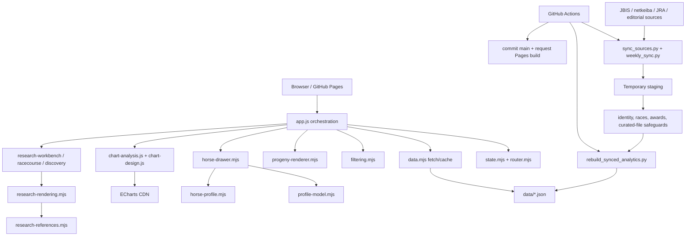

# Duramente Progeny Database：全仓技术审计

**审计日期：** 2026-10-28  
**审计基线：** `codex/profile-refinement-polish` / `b6baef7`，已合并 `origin/main` `966a9e6`（含 PR #6 与最新周更）  
**审计范围：** 当前 Git 跟踪的主应用、模块、样式、数据管线、GitHub Actions、测试与文档。未跟踪的 `video-demo/` 和 `data/racecourse-coordinates.json` 不作为发布代码评估。  
**约束：** 本报告只做审计和规划。未修改应用代码、统计公式、数据或依赖，也未实施下列路线图。

## A. Executive Summary

该项目的工程健康度整体为**中上**。对于一个无需后端的静态数据产品，它已经具备多项成熟措施：

- 数据抓取先进入临时目录，合并、重建和核对通过后才原子替换正式数据。
- 周末赛果、动态/静态赛果快照、JRA 官方胜马表、马匹身份和赛事历史之间存在多道 fail-closed 校验。
- 派生统计、人工研究和赛果同步有明确的数据所有权边界。
- URL 状态、CSV 安全、缺失值、同母标识、场地区分、A/B 比较和移动交互都有针对性测试。
- PR #6 将研究元数据、渲染和样式分开，并移除了全局 DOM 观察与文字改写，边界清晰。

主要弱点是：

- `app.js` 仍是 4,705 行的中央编排与领域渲染文件，种牡马、血统、生产、赛马场和图表生命周期都集中在这里。
- GitHub Actions 不执行现有浏览器回归，复杂 UI 改动不能由 PR 自动阻止。
- Cross 解析器存在可复现的多模式拼接错误；当前语料恰好没有触发，但未来上游格式变化会产生错误祖先统计。
- `summary.json` 的 facets 不被周更重建，也缺少与主清单的一致性测试。
- JBIS 月度队列只在每月 1–6 日运行；当前 10 月游标为 480/689，剩余批次本月不会再运行。
- 搜索每输入一个字符都会新增浏览器历史记录，返回键会逐步倒退到每个中间查询。
- CSS 通过 `@import` 形成额外请求链，Profile 样式存在多轮覆盖和重复媒体查询。

**严重度结论：** 未发现 P0；发现 2 个 P1、6 个 P2、4 个 P3。  
最优先事项不是框架替换，而是先补浏览器 CI 和数据不变量测试，再分别修复 Cross、facets、JBIS 游标和搜索交互，最后按领域逐步拆分 `app.js`。

## B. Repository Architecture Overview



### 主要模块和职责

| 层 | 主要文件 | 责任 |
| --- | --- | --- |
| Bootstrap / orchestration | `index.html`, `app.js` | DOM 容器、全局事件、页面装配、分析图表和若干领域计算 |
| State / URL | `src/state.mjs`, `src/router.mjs` | 当前页面、筛选、分页、详情和 URL 往返 |
| Data client | `src/data.mjs` | 静态 JSON 路由、请求去重、缓存、重试 |
| Listing | `src/filtering.mjs`, `src/progeny-renderer.mjs`, `src/csv.mjs` | 搜索、筛选、排序、列表和导出 |
| Profile | `src/horse-drawer.mjs`, `src/profile-model.mjs`, `src/horse-profile.mjs`, `src/life-records.mjs` | 详情生命周期、稳定身份匹配、分段资料和证据展示 |
| Research UI | `src/research-workbench.mjs`, `src/racecourse-analysis.mjs`, `src/racecourse-map.mjs` | A/B、地图、赛马场和筛选下钻 |
| Citation system | `src/research-references.mjs`, `src/research-rendering.mjs`, `styles/research-references.css` | 数据、HTML 渲染和响应式样式分离 |
| Statistical builders | `scripts/analytics_core.py`, `scripts/build_*.py` | 统计派生、Dosage、AWD、图表洞察、繁殖与同母资料 |
| Synchronization | `scripts/sync_sources.py`, `scripts/weekly_sync.py`, `scripts/rebase_sync.py` | 来源解析、暂存、校验、发布和并发版本处理 |
| Verification | `tests/*.mjs`, `scripts/tests/*.py`, `scripts/smoke_*.cjs` | 纯函数、数据完整性、浏览器交互和视觉回归 |

### 实际数据流

1. 首页读取 `summary.json`，再加载 `horses.json` 与 `career_history.json`；列表通过 `filtering.mjs` 在浏览器内筛选并分页。
2. 单马详情读取 `data/horses/<id>.json`，并与同母、退役后、更新、来源等目录按稳定 ID 交叉核对。
3. 分析页按需加载对应 `data/analytics/*.json`，ECharts 只在进入分析页时从 CDN 加载。
4. 周更先复制 `data/` 到临时目录，逐项抓取和 merge；全部指定马匹通过后才重建派生分析、验证并替换正式 JSON。
5. GitHub Actions 提交验证后的数据，再由 `rebase_sync.py` 处理仅限静态版本字符串的远端并发变化，然后请求 Pages 构建。

PR #6 的 citation 边界整合良好：`research-references.mjs` 不产生 HTML，`research-rendering.mjs` 负责转义和引用展示，CSS 负责响应式密度，应用模板显式写入链接用途。没有继续保留全局 `MutationObserver` 或全局箭头文本改写。

## C. Detailed Findings

### AUD-01 — P1 — Architecture / Maintainability

**Affected:** [`app.js`](https://github.com/Dacron92mr/duramente-progeny-database/blob/b6baef7/app.js#L2197), [`renderChart()`](https://github.com/Dacron92mr/duramente-progeny-database/blob/b6baef7/app.js#L764), [`renderPedigreeAnalysis()`](https://github.com/Dacron92mr/duramente-progeny-database/blob/b6baef7/app.js#L3298), [`renderProductionAnalysis()`](https://github.com/Dacron92mr/duramente-progeny-database/blob/b6baef7/app.js#L3776), [`renderRacecourseAnalysis()`](https://github.com/Dacron92mr/duramente-progeny-database/blob/b6baef7/app.js#L3935)

**Description:** `app.js` 目前同时承担启动、URL/状态协调、导航、列表、图表生命周期、种牡马、血统、生产、赛马场、俱乐部统计和事件绑定。主文件 4,705 行，图表函数和领域页面持续增加时，任何导航或配置改动都可能影响多个页面。

**Evidence:** 文件行数统计为 4,705；仅 `app.js` 内就有 76 处 `addEventListener()` 和 47 处 `querySelectorAll()`。四个主要分析页各由数百行模板、数据选择、控件事件和图表调用组成。

**Consequences:** 新增指标时容易复制模板和阈值，修改图表 API 时需要跨越多个长函数，代码审查难以定位副作用。这是长期可维护性问题，不是当前功能错误。

**Recommended solution:** 按领域逐步迁移，而不是一次性重写：

1. 先提取种牡马页面装配与图表函数到 `src/sire-analysis.mjs`。
2. 再迁移血统、生产、赛马场，每次只迁移一个领域。
3. 共享部分只抽取已验证的图表配置和模板 helper，不为短函数建立空转抽象。

**Risk:** 中高。迁移时可能改变图表初始化顺序、事件监听或 DOM ID。

**Complexity:** L。**Tests first:** 是。现有对应 smoke suite 应先成为迁移门禁。

### AUD-02 — P1 — Testing / Reliability

**Affected:** [`.github/workflows/checks.yml`](https://github.com/Dacron92mr/duramente-progeny-database/blob/b6baef7/.github/workflows/checks.yml#L19-L31), [`docs/DEVELOPMENT.md`](https://github.com/Dacron92mr/duramente-progeny-database/blob/b6baef7/docs/DEVELOPMENT.md#L29-L40), `scripts/smoke_*.cjs`

**Description:** CI 只运行语法、Node 纯函数、Python 单元、图表与数据检查。浏览器测试覆盖了结构、交互、响应式、地图和引用，但全部要求本地手动执行。

**Evidence:** `checks.yml` 从第 19 行到第 31 行没有安装 Playwright 或启动本地 HTTP 服务；开发文档明确写明浏览器测试需本地运行。

**Consequences:** DOM 选择器、响应式布局、动态抽屉、地图和点击下钻回归可以在 CI 全绿时合并。

**Recommended solution:** 增加一个独立 CI job，只跑高价值浏览器子集：

- `smoke_ui.cjs`
- `smoke_profile.cjs`
- `smoke_research.cjs`
- `smoke_references.cjs`

使用固定 Playwright 版本、缓存浏览器、启动本地服务器；外链只验证 href/rel，不依赖第三方站点在线。其余截图型套件可继续在发布前本地运行。

**Risk:** 低到中。会提高 CI 时长和浏览器安装成本。

**Complexity:** M。**Tests first:** 是；这本身就是测试基础设施。

### AUD-03 — P2 — Data Integrity / Statistical Correctness

**Affected:** [`parse_crosses()`](https://github.com/Dacron92mr/duramente-progeny-database/blob/b6baef7/scripts/analytics_core.py#L343-L362)

**Description:** Cross 输入以“祖先：多个位置串”为结构，但当前正则只把同一个祖先后的第一个 `S×M` 组合纳入该祖先；遇到逗号、分号或顿号分隔的第二个组合时，前缀会污染下一个祖先名。

**Evidence:** 用以下合法样式输入：

```text
Mr. Prospector: S4×M4, S4×M5
Northern Dancer: S5×M5
```

实际返回第二个祖先为 `S4×M5 Northern Dancer`，而不是 `Northern Dancer`。当前 `data/horses.json` 扫描结果为 **0 条受影响记录**，因此不是当前已发布数据的 P0 损坏，但解析器对未来同源格式没有防护。

**Consequences:** 若上游改变分隔格式，祖先名称、祖先组合、Cross 频数、代表马和胜马率都会归到错误组。合计可能仍通过总数检查，但分组含义已错。

**Recommended solution:** 先增加失败测试，再按分隔符切分“祖先＋模式列表”；保留现有无逗号格式兼容。验证祖先名不包含 `S/M` 位置、逗号、分号或顿号，并对比当前语料输出不变化。

**Risk:** 中。Cross 输出会进入 `pedigree.json`、`charts.cross_bubble` 和页面表格。

**Complexity:** S。**Tests first:** 必须。

### AUD-04 — P2 — Data Integrity / Synchronization

**Affected:** [`data/summary.json` ownership note](https://github.com/Dacron92mr/duramente-progeny-database/blob/b6baef7/docs/DATA_SCHEMA.md#L9), [`validate()`](https://github.com/Dacron92mr/duramente-progeny-database/blob/b6baef7/scripts/weekly_sync.py#L121-L138), [`tests/core.test.mjs`](https://github.com/Dacron92mr/duramente-progeny-database/blob/b6baef7/tests/core.test.mjs#L70-L77)

**Description:** `summary.json` 保存列表总数和 facets，但周更不重建，也不在 `validate()` 中与 `horses.json` 对账。当前快照与清单一致，但一致性没有被自动化保证。

**Evidence:** 文档明确写明周更不会重建 summary；`validate()` 检查清单、详情、图表和奖金覆盖，没有检查 facets；现有 inventory 测试只检查列表/详情名称，不检查 summary 数量。

**Consequences:** 新增译名、牧场、母父或分类后，筛选菜单可能缺失新值或显示旧数量。马匹总数仍固定为 726，因此当前风险有限，但资料维护仍会逐步产生偏差。

**Recommended solution:** 新增只读一致性测试，先验证：

- `summary.horses` 等于 `horses.json` 长度；
- 年份、性别、颜色、所属、成就等 facets 值集合和计数等于清单聚合；
- 每次显式改变 facets 的维护流程更新 summary；周更只在影响 facets 时重建。

**Risk:** 低。测试先行；重建 builder 时避免覆盖人工元数据。

**Complexity:** S。**Tests first:** 必须。

### AUD-05 — P2 — Reliability / Scheduling

**Affected:** [`.github/workflows/jbis-weekly-queue.yml`](https://github.com/Dacron92mr/duramente-progeny-database/blob/b6baef7/.github/workflows/jbis-weekly-queue.yml#L3-L5), [`weekly_sync.py` cycle/cursor](https://github.com/Dacron92mr/duramente-progeny-database/blob/b6baef7/scripts/weekly_sync.py#L215-L239), [`.github/sync/state.json`](https://github.com/Dacron92mr/duramente-progeny-database/blob/b6baef7/.github/sync/state.json#L1-L4)

**Description:** JBIS 队列只在每月 1–6 日运行四次/日。进入新月份时游标无条件归零；如果上一月没有完成整个队列，剩余马匹只能下一月从队首重新排队。

**Evidence:** 当前日期为 2026-10-28，状态仍为 `jbis_cycle: 2026-10`、`jbis_cursor: 480`，而带 JBIS ID 的马匹为 689。10 月余下日期不会再有该 workflow。另一次批次失败或晚启用都可能留下未完成尾部。

**Consequences:** 当前 209 个尾部档案不会在 10 月获得这一轮的 JBIS 奖金刷新；数据不会被覆盖，但可能陈旧到下一轮。若失败集中在月末，问题会重复。

**Recommended solution:** 月份变化时，如果上一周期未完成，优先继续上一游标直到完成，再开启新周期；或在 1–6 日后安排 catch-up run。状态应保存 cycle completion 和 last attempt 结果，而非只有 cursor。

**Risk:** 中。错误推进游标可能跳过马匹；应只在前一批通过发布后推进。

**Complexity:** S/M。**Tests first:** 是，覆盖“完成、中途失败、跨月未完成、全部完成”四种状态转换。

### AUD-06 — P2 — UX / Performance

**Affected:** [`updateSearch()` and input handlers](https://github.com/Dacron92mr/duramente-progeny-database/blob/b6baef7/app.js#L4509-L4525)

**Description:** 搜索输入每变化一次就立即 `writeUrlState("push")`，导致每个字符生成一条历史记录。

**Evidence:** 本地 1440px Chrome、726 匹数据下输入 `タイトルホルダー` 8 个字符，`history.length` 增加 8。单次 DOM 更新约 1.4–8.2 ms，说明主要问题不是计算性能，而是导航语义和重复渲染。

**Consequences:** 用户按返回键会依次经过多个不完整查询，而不是回到上一页面；连续输入也产生不必要 URL 写入和列表渲染。

**Recommended solution:** 对搜索使用 150–250 ms debounce；输入期间以 `replaceState` 更新 URL，稳定后再决定是否 push；继续同步桌面/移动搜索框。

**Risk:** 低。需确保清空、快捷筛选、分页和返回恢复行为不变。

**Complexity:** S。**Tests first:** 是，增加历史栈和输入联动测试。

### AUD-07 — P2 — CSS / Maintainability

**Affected:** [`style.css` imports](https://github.com/Dacron92mr/duramente-progeny-database/blob/b6baef7/style.css#L1-L17), [`styles/profile.css` overrides](https://github.com/Dacron92mr/duramente-progeny-database/blob/b6baef7/styles/profile.css#L52-L105), `styles/analysis.css`

**Description:** 根样式通过 `@import` 引入多个文件，Profile 文件内部存在多轮追加覆盖和重复 `max-width:600px` 媒体查询。当前视觉可用，但修改某一规则时需要理解加载顺序和多处覆盖。

**Evidence:** `style.css` 有 10 个 `@import`；`styles/profile.css` 有 5 个 `max-width:600px` 媒体块；全站 CSS 统计有 26 个 `!important` 和 117 个 ID 选择器出现位置。`analysis.css` 达 3,510 行。

**Consequences:** 样式回归难定位，新增组件可能继承旧 ID/覆盖规则。`@import` 还增加 CSS 请求发现链。

**Recommended solution:** 保持现有视觉，不在本轮重写：

- 将根 `@import` 改为按顺序的 `<link>`，避免嵌套 CSS 请求链；
- 每个组件只保留一个响应式区段；
- 新规则优先 class/token，不继续追加 ID 覆盖；
- 每次只合并一个模块的重复规则，并保留截图回归。

**Risk:** 中。加载顺序和 specificity 很容易改变。

**Complexity:** M。**Tests first:** 是；至少覆盖四屏宽和双主题。

### AUD-08 — P2 — Security / Dependency Supply Chain

**Affected:** [`loadChartLibrary()`](https://github.com/Dacron92mr/duramente-progeny-database/blob/b6baef7/src/chart-loader.mjs#L1-L15)

**Description:** ECharts 从 jsDelivr 加载固定版本，但没有 Subresource Integrity 或 vendor 本地副本。第三方脚本拥有页面同源执行权限。

**Evidence:** 动态创建 `<script src="https://cdn.jsdelivr.net/npm/echarts@5.6.0/dist/echarts.min.js">`，没有 `integrity` 和 `crossorigin`。

**Consequences:** CDN 内容被替换或供应链受损时，分析页脚本可在站点上下文执行。风险不高但影响面大。

**Recommended solution:** 采用带 SRI hash 的固定资源；或把固定版本 vendor 到仓库。保留当前按需加载，不因 SRI 改为首屏加载。

**Risk:** 低。SRI 配置错误会阻断所有图表，需浏览器回退测试。

**Complexity:** S。**Tests first:** 是，模拟加载成功与失败。

### AUD-09 — P3 — Statistical Consistency

**Affected:** [`add_horse()`](https://github.com/Dacron92mr/duramente-progeny-database/blob/b6baef7/scripts/analytics_core.py#L199-L214), [`add_sire_horse_metrics()`](https://github.com/Dacron92mr/duramente-progeny-database/blob/b6baef7/scripts/analytics_core.py#L501-L515), [`horseStarts()`](https://github.com/Dacron92mr/duramente-progeny-database/blob/b6baef7/app.js#L2557-L2570)

**Description:** Python 将 `race_count > 0` 作为出赛后备条件，而该计数包含所有 race 行，包括取消/除外等非正式起跑；前端 `horseStarts()` 只看 `career_summary` 的 `N戦`。

**Evidence:** 当前语料中，正式名次出赛马、存在 race 行马匹和 `overview.summary.runners` 都为 655，**没有现行差异**。只有在未来出现“仅有非起跑记录、无生涯文字”的马时才会分叉。

**Consequences:** 出赛率和分母可能在不同页面采用不同定义。

**Recommended solution:** 统一采用 `is_valid_start()` 或已发布的 profile summary 口径；增加一组仅有取消/除外记录的反例测试。

**Risk:** 低到中。会改变未来缺失/异常数据的显示。

**Complexity:** S。**Tests first:** 必须。

### AUD-10 — P3 — Performance / Chart Lifecycle

**Affected:** [`mountCourseAnalysis()`](https://github.com/Dacron92mr/duramente-progeny-database/blob/b6baef7/src/racecourse-analysis.mjs#L10-L38)

**Description:** 每次距离图切换都会先 dispose 旧图，再把新图 push 到 `charts` 数组；数组还保留此前已 dispose 的实例。

**Evidence:** `distance()` dispose 旧 `distanceChart` 后执行 `charts.push(distanceChart)`；只有切换赛事体系时 `dispose()` 才清空数组。

**Consequences:** 正常交互下影响很小，但频繁切换赛马场会产生无意义引用积累。

**Recommended solution:** 距离图使用单独变量，不加入一次性渲染列表；或在替换前从数组中移除旧实例。

**Risk:** 低。

**Complexity:** S。**Tests first:** 可选，现有 research smoke 足够覆盖行为。

### AUD-11 — P3 — Code Cleanup

**Affected:** [`mountDiscovery()`](https://github.com/Dacron92mr/duramente-progeny-database/blob/b6baef7/src/discovery.mjs#L7-L9), [`metricCard()`](https://github.com/Dacron92mr/duramente-progeny-database/blob/b6baef7/app.js#L1058-L1069), [RACECOURSE_COORDINATES](https://github.com/Dacron92mr/duramente-progeny-database/blob/b6baef7/app.js#L100-L125)

**Description:** `mountDiscovery()` 接收未使用的 `fetchData`；`metricCard()` 保留当前无调用方使用的 `href` 分支；赛马场坐标内嵌在 `app.js`。

**Evidence:** `mountDiscovery` 函数体未读取第三个参数；所有现行 `metricCard()` 调用都没有第四个参数；坐标表为 24 行内联对象。

**Consequences:** 增加阅读成本，坐标维护无法独立测试或复用。

**Recommended solution:** 删除死参数/死分支；若地图坐标需要由数据流程维护，再迁移到受版本控制的 `data/racecourse-coordinates.json` 并加身份校验。

**Risk:** 低。

**Complexity:** S。**Tests first:** 否，但需先确认没有动态调用。

### AUD-12 — P3 — Security / CI Hardening

**Affected:** [`checks.yml` actions](https://github.com/Dacron92mr/duramente-progeny-database/blob/b6baef7/.github/workflows/checks.yml#L12-L18), sync workflows

**Description:** GitHub Actions 使用 `@v4` / `@v5` 浮动 tag，而非 commit SHA。当前没有发现 secret 泄漏，workflow 权限也基本按用途设置。

**Evidence:** 所有 workflow 均使用 `actions/checkout@v4`、`actions/setup-python@v5` 或 `actions/upload-artifact@v4`。

**Consequences:** tag 被重新指向时可引入非预期 action 代码。

**Recommended solution:** 逐步固定到审查过的 commit SHA，并用 Dependabot/Renovate 管理更新。

**Risk:** 低；需保持 action 升级可追踪。

**Complexity:** S。**Tests first:** 否。

## D. Quick Wins

1. **先补失败测试再修 Cross 多模式解析。** 当前语料输出不需要变化，风险可控。
2. **增加 summary facets 一致性测试。** 纯读测试，不改变数据流程。
3. **修复搜索历史。** 用 debounce + replaceState，不改变筛选结果。
4. **把浏览器主套件纳入 CI。** 先跑 3–4 个高价值 smoke，不要求全部截图套件上 CI。
5. **为 ECharts 增加 SRI 或本地 vendor。**
6. **固定 Actions SHA。**
7. **清理距离图实例数组和未使用参数。**

## E. High-Risk Areas

以下区域不应在没有回归测试的情况下重构：

- [`weekly_sync.py`](https://github.com/Dacron92mr/duramente-progeny-database/blob/b6baef7/scripts/weekly_sync.py#L121-L269)：暂存、合并、验证和原子替换。
- [`rebase_sync.py`](https://github.com/Dacron92mr/duramente-progeny-database/blob/b6baef7/scripts/rebase_sync.py#L17-L37)：会 amend/rebase 自动提交，只允许处理静态版本字符串。
- [`analytics_core.py`](https://github.com/Dacron92mr/duramente-progeny-database/blob/b6baef7/scripts/analytics_core.py#L199-L251)：多个页面的共同分母和派生字段从这里输出。
- `horse-drawer.mjs` 与净计分 ID 匹配：应从列表、详情、繁殖目录和同母女马 ID 之间保持三方一致。
- `index.html` 的 `STATIC_DATA_VERSION`：脚本依赖固定格式替换；破坏格式会阻止发布。
- 全局 CSS 顺序和 Profile specificity：局部规则可能影响多个页面。

## F. Recommended Refactoring Roadmap

### PR A — Browser CI and dataset invariants

**Objective:** 让关键 UI 和跨文件数据不变量在 PR 中自动失败。  
**Scope:** 新增浏览器 CI job；增加 summary facets、清单/详情、外部 URL 协议和静态资源存在性测试。  
**Likely files:** `.github/workflows/checks.yml`, `tests/*.mjs`, `package.json`。  
**Dependencies:** 无。  
**Benefit:** 为后续所有数据/拆分改动加安全网。  
**Regression risk:** CI 时长和浏览器网络依赖。  
**Required tests:** `test:browser`, `test:profile`, `test:research`, `test:references`。  
**Acceptance:** PR 在仅运行 CI 的环境中完成浏览器检查并报告明确失败。

### PR B — Cross parser delimiter correctness

**Objective:** 正确处理同一祖先的多个位置组合和逗号/分号/顿号分隔。  
**Scope:** 只修改解析器与其测试，不改统计模型或当前语料。  
**Likely files:** `scripts/analytics_core.py`, `scripts/tests/test_*`。  
**Dependencies:** PR A 可先合入，但不是硬依赖。  
**Benefit:** 防止未来来源格式变化污染祖先与 Cross 分组。  
**Regression risk:** 可能改变现有解析输出；需锁定当前输出。  
**Required tests:** 逗号、分号、顿号、无分隔、重复形式、当前全库快照。  
**Acceptance:** 新样例返回正确祖先；当前 726 匹解析快照不变。

### PR C — Summary facets validation/rebuild

**Objective:** 让筛选快照和主清单保持一致。  
**Scope:** 新增只读测试；如需 builder，只处理 facets 和总数。  
**Likely files:** `tests/core.test.mjs`, 可能新增 `scripts/build_summary.py`。  
**Dependencies:** PR A。  
**Benefit:** 防止筛选菜单缺失或数量过期。  
**Regression risk:** 覆盖人工 summary 字段。  
**Required tests:** 所有 facets 的值和计数。  
**Acceptance:** 测试能捕获任一 facet 差异；builder 只更新拥有字段。

### PR D — JBIS monthly cursor continuation

**Objective:** 跨月时继续未完成批次，并记录当前周期完成状态。  
**Scope:** 状态转换和 workflow catch-up；不改 JBIS 解析。  
**Likely files:** `scripts/weekly_sync.py`, `.github/sync/state.json`, workflow, Python tests。  
**Dependencies:** PR A。  
**Benefit:** 避免尾部档案等待下一周期，减少月度覆盖缺口。  
**Regression risk:** 游标错误导致跳马。  
**Required tests:** 跨月完成/未完成、批次失败、全量完成。  
**Acceptance:** 一次失败不会静默跳过未尝试档案。

### PR E — Search interaction cleanup

**Objective:** 减少重复渲染并修正浏览器历史语义。  
**Scope:** 搜索 debounce、replace/push 策略和双输入框同步。  
**Likely files:** `app.js`, `tests/core.test.mjs`, `scripts/smoke_ui.cjs`。  
**Dependencies:** PR A。  
**Benefit:** 更可预测的返回键和更少无意义渲染。  
**Regression risk:** 搜索状态/URL 同步。  
**Required tests:** 快速输入、清空、过滤组合、返回键。  
**Acceptance:** 8 字符查询不再新增 8 条历史记录。

### PR F — Extract sire analysis

**Objective:** 将种牡马页面、图表和控件从 `app.js` 迁出。  
**Scope:** 只迁移种牡马，保持所有 ID、DOM 和回调契约。  
**Likely files:** `app.js`, 新增 `src/sire-analysis.mjs`, tests/smoke。  
**Dependencies:** PR A。  
**Benefit:** 为其他分析页迁移建立可复用模式。  
**Regression risk:** 图表初始化、事件和 URL 子页。  
**Required tests:** 所有 sire smoke 和图表配置快照。  
**Acceptance:** `app.js` 减少而不改变页面行为。

### PR G — Extract pedigree analysis

**Objective:** 迁移 BMS、牝系、Cross、Dosage 页面装配。  
**Scope:** 一次只迁移血统领域；统计 builder 不变。  
**Likely files:** `app.js`, 新增 `src/pedigree-analysis.mjs`, tests。  
**Dependencies:** PR B、PR F。  
**Benefit:** 将最复杂的分析阅读逻辑与全局启动分离。  
**Regression risk:** 多种下钻、图例、分组筛选。  
**Required tests:** pedigree smoke、引用、Cross、Dosage、A/B。  
**Acceptance:** 所有图形与下钻行为一致。

### PR H — Production/racecourse extraction and chart ownership

**Objective:** 迁移生产和赛马场分析，并统一图表生命周期 helper。  
**Scope:** 两个领域分次迁移；不重写地图聚类和统计公式。  
**Likely files:** `app.js`, `src/production-analysis.mjs`, `src/racecourse-*`, chart lifecycle tests。  
**Dependencies:** PR F/G。  
**Benefit:** 降低未来增加分析图表时对中央文件的依赖。  
**Regression risk:** 地图、桑基、年龄/胎次/月份联动。  
**Required tests:** production、racecourse、research smoke。  
**Acceptance:** 页面 ID/URL/下钻一致，旧图表实例无积累。

## G. What Should NOT Be Refactored Yet

- **不要引入 React、Vue 或构建框架。** 当前 726 条静态数据、无后端、GitHub Pages 部署的原生方案仍然合理。
- **不要改写统计公式。** 现有分母、缺失值、AWD、Dosage、AEI/CPI 和研究解释已经有多层测试和文档。
- **不要绕过 staging + validation + `rebase_sync.py`。** 这是目前防止周更破坏人工资料的核心保障。
- **不要合并原始赛果和派生统计的所有权。** `data/` 是混合所有权目录，不是单一生成缓存。
- **不要移除地图屏幕空间聚类。** 它解决真实覆盖问题，现有测试也覆盖重合与缩放。
- **不要把引用数据、渲染和 CSS 重新耦合。** PR #6 的拆分和显式链接属性是合理边界。
- **不要在无 CI 浏览器门禁时拆分 `app.js`。** 先建立 PR A，再做迁移。

## H. Overall Assessment

**Architecture:** 对静态数据站而言合理，模块边界正在改善；主要问题是领域分析仍集中在 `app.js`。不建议框架重写，建议按页面迁移。

**Readability:** 纯函数和文档总体清楚，但旧分析 CSS 与部分 JS 存在压缩写法、重复覆盖和长模板。新增代码应保持明确命名和分层。

**Maintainability:** 数据所有权文档、专用 builder 和测试是显著优势。需要避免继续向中央文件增加解析器、图表和事件。

**Reliability:** 数据发布保护强于一般静态项目。当前主要缺口是 JBIS 周期状态和浏览器 CI。

**Data Integrity:** 马匹身份、赛果快照、奖金和人工分类校验较好；Cross 多模式解析与 summary facets 是下一阶段最值得补的两处。

**Performance:** 对 726 条数据表现可接受。本地测得的列表可用时间约 266 ms、分析页首次可用约 1.56 s；这些是本地数据，不代表真实移动网络。优先修复重复搜索历史，而不是做微小算法优化。

**Test Coverage:** 数据与纯函数覆盖较强，浏览器套件内容丰富；缺少 CI 执行是最大体系化风险。

**Extensibility:** 新增研究主题和引用已较轻量；新增完整分析页面仍会增加 `app.js`。先完成测试门禁，再迁移一个领域是合适的下一阶段。

## Verification Evidence

### Executed successfully

- `npm test`：53 tests passed。
- `python3 -m unittest discover -s scripts/tests -v`：55 tests passed。
- `npm run test:browser`：26/26 passed。
- Profile、research、content/photo、careers、post-merge、references、corrections、PR3 浏览器回归通过。
- Chart color、Sankey、chart design、horse relatives、research charts、chart insights 检查通过。

### Not executed

- WebKit mobile smoke：当前 Playwright WebKit runtime 未安装，启动时明确报告缺少 `webkit-2336/pw_run.sh`。这不是页面功能失败，也不能替代为“WebKit 通过”。

### Local performance observations

Browser: local Google Chrome, viewport 1440×1000, local Python static server.

| Scenario | Measurement |
| --- | ---: |
| 首页 DOM 可交互前 | `DOMContentLoaded ≈ 181.8 ms` |
| 首屏列表 JSON/渲染后 | `≈ 266.3 ms` |
| 首页资源请求数 | `52` |
| 逐字搜索每次 DOM 更新 | `1.4–8.2 ms` |
| 8 字符搜索增加历史记录 | `8` |
| 种牡马分析页首次可用 | `≈ 1.56 s` |
| 种牡马子页切换 | `154–213 ms`（含两帧等待） |
| 切换到其他分析页 | `204–219 ms`（ECharts 已缓存、本地服务） |

这些数字用于定位问题，不作为上线 SLA；ECharts CDN、真实网络和 GitHub Pages 压缩会影响真实结果。

## Audit Conclusion

项目已经超过“原型”质量：数据保护、身份校验、缺失值语义、测试和文档都有实质投入。当前不需要大规模重写，而是应当先建立浏览器 CI 和跨文件数据不变量，再修复少数可复现的解析/同步/交互问题，最后按领域拆分 `app.js`。

本报告完成后不应自动开始路线图中的重构；等待明确选择下一项任务。
