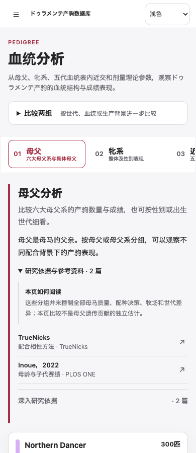
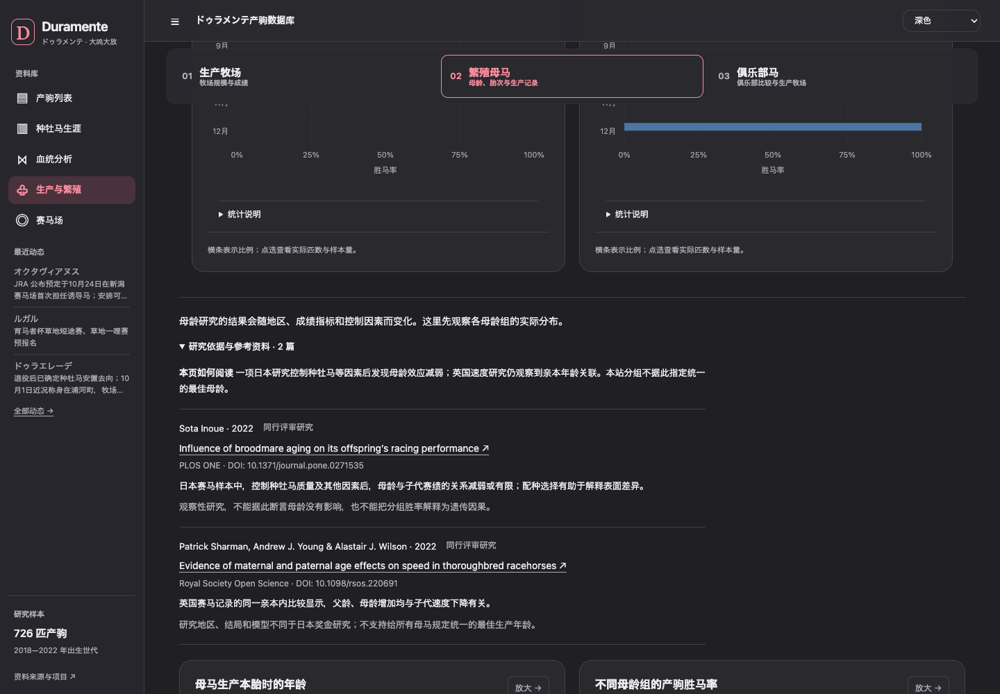
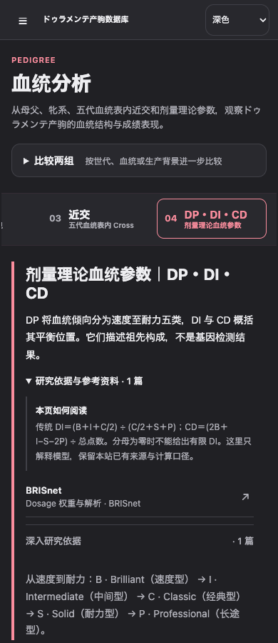

# Research references and link semantics

Verified October 28, 2026. This branch only changes explanatory and presentation layers; no data files or statistical formulas are changed. The separate profile polish remains in its original working directory.

## Reading design

Each topic has a short visible context paragraph and a closed native disclosure. Desktop keeps the richer reference row with full metadata, DOI, Chinese summary, and limitations. Below 600 px, the opened list becomes compact two-line citations; the complete research explanation and limitations live in a second optional disclosure. References remain editorial rows rather than cards, with metadata at 12–14 px.

- Accent/right arrow: internal horse profiles, filters, population drill-downs.
- Neutral/underlined/external arrow: research and methodology.
- Muted/dotted underline/external arrow: original data and provenance; original URLs and dates retained.

Purpose is assigned with explicit `data-link-purpose` attributes at the render site and styled directly from CSS. This avoids global DOM scans, text rewriting, duplicated arrows, and changes to accessible names. Dynamically rendered charts, update history, and the Full Profile drawer carry the same attributes in their own templates, so no global `MutationObserver` is required.

## Module boundaries

- `src/research-references.mjs` owns source records, evidence types, full metadata, compact mobile metadata, and topic mapping.
- `src/research-rendering.mjs` owns citation markup, accessible labels, responsive reading levels, and metadata escaping.
- `styles/research-references.css` owns the desktop/mobile reading density and the three link-purpose styles.
- `src/ux-copy.mjs` only composes concept titles with the reusable research renderer.

Adding a study requires one source record and its topic reference ID. Adding a topic requires the context, caveat, and referenced source IDs; no `app.js` citation list is needed.

## Verified registry

| ID | Publication | Verification and scope |
| --- | --- | --- |
| truenicks | TrueNicks. [Frequently Asked Questions](https://www.truenicks.com/faq). TrueNicks. | 行业方法. 介绍如何比较种牡马与特定母父组合相对于其他配合的重赏胜马表现。 专有评分方法，不等于本站的胜马率、重赏马比例或 A/B 比较。 |
| dosage | BRISnet. [Explanation of Dosage](https://www.brisnet.com/cgi-bin/static.cgi?page=expdosage). Bloodstock Research Information Services. | 行业方法. DP 按 Brilliant、Intermediate、Classic、Solid、Professional 五类汇总指定祖先。前四代依次赋予 16、8、4、2 点；跨两类祖先分摊点数。DI 比较速度端与耐力端，CD 表示加权重心。 这是传统血统模型，依赖祖先名单与分类，不是基因检测，也不能单独预测能力。页面祖先名单数量为历史版本。 |
| ishige2026 | Taichiro Ishige et al. (2026). [Genetic diversity and genomic inbreeding trends in the Japanese Thoroughbred population](https://www.jstage.jst.go.jp/article/jes/37/3/37_2607/_article/-char/ja). Journal of Equine Science; DOI 10.1294/jes.37.77. | 同行评审研究. 比较日本不同出生年的 SNP 与连续纯合片段（ROH），观察到遗传多样性略降、基因组近交上升。 研究对象是群体遗传结构；不能用某个五代 Cross 推算单马的 ROH 或赛绩。 |
| hill2022 | Emmeline W. Hill et al. (2022). [Inbreeding depression and the probability of racing in the Thoroughbred horse](https://www.pure.ed.ac.uk/ws/files/285856215/rspb.2022.0487.pdf). Proceedings of the Royal Society B; DOI 10.1098/rspb.2022.0487. | 同行评审研究. 研究发现基因组近交、尤其较长 ROH，与较低的出赛概率有关。 主要结局是是否出赛，不是某个祖先的重复能否提高胜率。研究群体不能直接替代本站产驹。 |
| todd2018 | Evelyn T. Todd et al. (2018). [Founder-specific inbreeding depression affects racing performance in Thoroughbred horses](https://pmc.ncbi.nlm.nih.gov/articles/PMC5906619/). Scientific Reports; DOI 10.1038/s41598-018-24663-x. | 同行评审研究. 澳洲纯血马的血统分析显示，不同奠基祖先相关的近交效应并不一致；较小基因组子样本未检出整体关联。 血统近交系数、SNP 与 ROH 不是同一指标；小样本及未控制的训练等环境因素限制解释。 |
| hill2002 | E. W. Hill et al. (2002). [History and integrity of thoroughbred dam lines revealed in equine mtDNA variation](https://www.tbheritage.com/GeneticMarkers/HillAnimalGenetics.pdf). Animal Genetics; DOI 10.1046/j.1365-2052.2002.00870.x. | 同行评审研究. 以线粒体 DNA 核对传统母系，发现部分血统记录与母系遗传关系不一致。 牝系编号用于追溯母系历史，并非遗传能力评分；本研究没有核验本站各匹马的 DNA。 |
| inoue2022 | Sota Inoue (2022). [Influence of broodmare aging on its offspring’s racing performance](https://journals.plos.org/plosone/article?id=10.1371/journal.pone.0271535). PLOS ONE; DOI 10.1371/journal.pone.0271535. | 同行评审研究. 日本赛马样本中，控制种牡马质量及其他因素后，母龄与子代赛绩的关系减弱或有限；配种选择有助于解释表面差异。 观察性研究，不能据此断言母龄没有影响，也不能把分组胜率解释为遗传因果。 |
| sharman2022 | Patrick Sharman, Andrew J. Young & Alastair J. Wilson (2022). [Evidence of maternal and paternal age effects on speed in thoroughbred racehorses](https://pmc.ncbi.nlm.nih.gov/articles/PMC9532991/). Royal Society Open Science; DOI 10.1098/rsos.220691. | 同行评审研究. 英国赛马记录的同一亲本内比较显示，父龄、母龄增加均与子代速度下降有关。 研究地区、结局和模型不同于日本奖金研究；不支持给所有母马规定统一的最佳生产年龄。 |
| jairs2017 | JAIRS（转译 BloodHorse 报道） (2017). [繁殖牝馬の将来の成功を左右する出生順についての研究（アメリカ）](https://www.jairs.jp/sp/contents/w_news/2017/12/6.html). JAIRS 海外競馬情報. | 行业研究报道. 讨论雌驹自身的出生顺序与日后作为繁殖母马的子代成绩，并介绍母马质量和样本选择问题。 行业报道，非同行评审论文；其后代繁殖表现不能直接当作本马竞技成绩的结论。 |
| fawcett2021 | Jeffrey A. Fawcett, Hideki Innan, Takeru Tsuchiya & Fumio Sato (2021). [Effect of advancing age on the reproductive performance of Japanese Thoroughbred broodmares](https://pubmed.ncbi.nlm.nih.gov/34220269/). Journal of Equine Science; DOI 10.1294/jes.32.31. | 同行评审研究. 日本配种记录显示，活产率与母龄、初次配种年龄及配种经历有关；持续留种的母马也存在选择差异。 活产、受孕与产驹获胜是不同结局，不能用胜马率代替繁殖成功率。 |
| onoda2014 | Tomoaki Onoda et al. (2014). [An Approach of Estimating Individual Growth Curves for Young Thoroughbred Horses Based on Their Birthdays](https://www.jstage.jst.go.jp/article/jes/25/2/25_1402/_article/-char/en). Journal of Equine Science; DOI 10.1294/jes.25.29. | 同行评审研究. 日本幼驹的生长曲线纳入出生日期与季节性补偿生长后，更贴近体重和体高记录。 研究结局是生长，不是胜率；出生月份与竞赛表现的联系仍需考虑相对月龄、管理及参赛选择。 |
| jbis-indices | JBIS-Search. [よくあるご質問：AEI・CPI](https://search.jbis.or.jp/help/faq/). 日本軽種馬協会. | 官方说明. AEI 将每匹出赛产驹的平均奖金与同期整体平均比较。CPI 按相关同母兄弟姐妹的平均奖金衡量母群背景；JBIS 分综合、中央与地方统计。 分子、分母和覆盖范围须一致。仅海外出赛的部分日本产马不计入 JBIS 指数，AEI/CPI 不是种牡马因果贡献。 |
| hill2010 | Emmeline W. Hill et al. (2010). [A Sequence Polymorphism in MSTN Predicts Sprinting Ability and Racing Stamina in Thoroughbred Horses](https://journals.plos.org/plosone/article?id=10.1371/journal.pone.0008645). PLOS ONE; DOI 10.1371/journal.pone.0008645. | 同行评审研究. 研究发现 MSTN 变异与最佳比赛距离相关，并在其他样本中验证。 最佳比赛距离不等于群体 AWD。本站没有基因型数据，不能从胜距反推某匹马的 MSTN 类型。 |
| takahashi2015 | Toshiyuki Takahashi (2015). [The effect of age on the racing speed of Thoroughbred racehorses](https://www.jstage.jst.go.jp/article/jes/26/2/26_1506/_article/-char/en). Journal of Equine Science; DOI 10.1294/jes.26.43. | 同行评审研究. JRA 草地与泥地资料按年龄、月份、性别和距离比较速度，观察到早期成长阶段的变化。 较差表现马提前退出可能影响较高年龄组的平均值；同龄比较仍不能消除参赛选择。 |
| jra-going | JRA. [馬場状態およびクッション値に関する情報](https://www.jra.go.jp/keiba/baba/kaisetsu/). 日本中央競馬会. | 官方说明. 说明马场状态、含水率及草地缓冲值的含义和测量背景。 场地类别并不包含全部跑道条件；同为草地或泥地也不能视为完全相同的竞赛环境。 |
| morioka | Horse Racing in Japan. [Morioka Racecourse](https://japanracing.jp/en/racing/go_racing/local_racecourses/n07.html). JRA / Horse Racing in Japan. | 官方说明. 盛冈同时设有泥地和草地跑道，地方赛事的场地分析需要把这类例外单独观察。 赛马场设施说明不是赛绩数据来源，也不证明某匹马适合该场地。 |
| nist-proportions | NIST / SEMATECH. [7.2.4.1. Confidence intervals](https://www.itl.nist.gov/div898/handbook/prc/section2/prc241.htm). e-Handbook of Statistical Methods. | 官方说明. 介绍比例的 Wilson 等区间方法，以及小样本下普通正态近似的局限。 这是统计方法参考。赛马记录并非随机独立试验，同一匹马多次出赛及选择参赛会限制推断。 |

## Verification notes

- Publisher articles/abstracts were read for Inoue (PLOS), Onoda, Takahashi and Ishige (J-STAGE). PubMed metadata and abstracts were checked for Fawcett, Hill 2010, Sharman and Todd. Sharman full text was read through PMC.
- Hill 2022 was read through the Edinburgh institutional publisher-PDF copy because the DOI destination returned 403. Hill 2002 was read in the original article PDF hosted by Thoroughbred Heritage and cross-checked against PubMed metadata. These links identify the actual publications, not generic homepages.
- Todd 2018: live PMC and Nature requests intermittently returned challenge/redirect errors; indexed PMC full-text findings and PubMed author/DOI metadata were available and matched. The reference is retained; availability from every reader's network is not guaranteed.
- Ishige 2026: DOI redirect initially failed. The exact J-STAGE article and matching PubMed record 42774253 verified authors, journal, year, DOI and abstract; no metadata was inferred from the DOI.
- TrueNicks FAQ and BRISnet Explanation of Dosage are industry methodology, not peer-reviewed papers. Their pages do not state a publication year; the UI omits a year rather than using access date as publication date.
- JAIRS is a translated industry report, credited to Julie Witt / The Blood-Horse (October 21, 2017; JAIRS December 20, 2017). Its reproductive outcome is not presented as the foal's own race result.
- JBIS FAQ definitions, JRA going explanation, official Morioka facility page and NIST interval guidance were read directly. The JBIS FAQ is a concept reference; the existing horse/sire result URL remains the original data source.

## Excluded or unresolved candidates

- BRISnet advdosage: returned HTTP 403; full contents/metadata not verified, so not included. The verified expdosage page supplies the traditional weighting and index explanation.
- No universal optimum maternal age, beneficial Cross, individual MSTN genotype, or farm/club causal advantage is asserted.
- No unrelated farm/club paper was added. NIST is identified only as general proportion methodology, not equine or ownership evidence.
- Birth-month evidence uses a Japanese growth study; it is explicitly not evidence of a birth-month win-rate effect.

## Placement

- 母父与母父系：`bms`（TrueNicks、Inoue 2022），显示于母父主分析。
- 配合相性：`nicking`（TrueNicks、Inoue 2022）。
- 剂量理论：`dosage`（BRISnet），包含 DP 五类、16／8／4／2 权重、DI 与 CD 的既有口径，并明确不是基因检测。
- 近交与 Cross：`cross`（Ishige 2026、Hill 2022、Todd 2018）。
- 牝系：`family`（Hill 2002）。
- 母龄、胎次、繁殖结果与出生月份：`maternalAge`、`parity`、`reproduction`、`birthMonth`，放在对应生产图表前。
- 生产牧场与俱乐部：`farm`；NIST 仅用于比例区间和小样本解释，不用于证明牧场因果优势。
- AEI／CPI、AWD、同龄世代与赛马场：`indices`、`awd`、`cohort`、`racecourse`，保留于对应分析页。

母父说明直接位于主分析；A/B 比较工具不再复制同一说明。研究内容按 17 条已核验资料映射到 14 个分析主题，不会退化为站点底部的一份总书目。

## Representative views

以下截图来自本地静态站点，只展示本站界面，不包含第三方论文或照片画面。

## Validation

Verified against the local static site on October 28, 2026:

- `node --check app.js`, every `src/*.mjs`, and `git diff --check` pass.
- 46 Node tests and 55 Python tests pass, along with the existing chart colour, Sankey, chart-design, horse-relative, research-chart and chart-insight checks.
- `npm run test:references` covers all 14 topics at 390, 430, 768 and 1440 px in light and dark themes. Mobile rows are capped at two visual lines and 48–64 px; desktop rows retain summaries and limits. Every disclosure starts closed, opens and closes, has no horizontal overflow and reports no page errors.
- The same browser test opens the secondary mobile research detail, expands the A/B tool, follows a real population drill-down, verifies representative-horse and update-history links as internal actions, checks source styling and the dynamic Full Profile drawer, and detects duplicate external-arrow indicators.
- In a fixed Production → Broodmare → Farm → Full Profile scenario, removing the global link observer reduced measured observer work from 12 callbacks, 2,353 changed nodes and about 5.6 ms to zero callbacks. This measures only the removed observer callback, not total page load time.
- Existing UI, Profile, research, content/photo, post-merge, discovery, career and mobile smoke suites remain the final cross-feature regression layer before PR review.

Remaining limitation: external publications can block some networks or change redirects. The registry preserves canonical verified identifiers, but availability cannot be guaranteed from every reader's network. No data file or statistical formula is changed by this branch.
